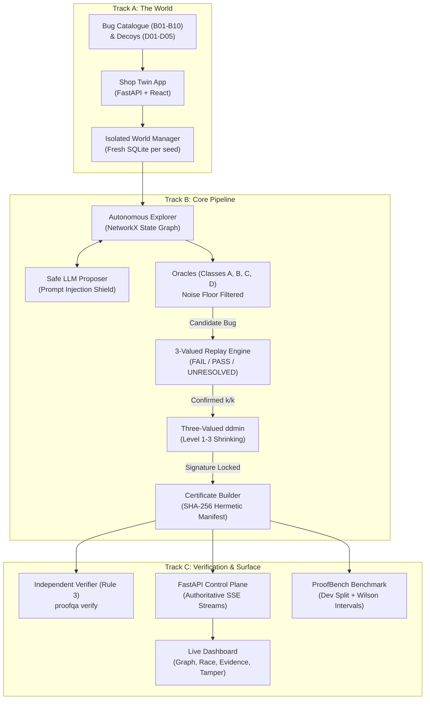

# ProofQA 2.0: The Verification-Native Autonomous QA Engineer

[](https://github.com/aniketmehetre/Code-Apex-ProofQA/actions/workflows/proofqa.yml)
[](docs/progress.md)
[](pyproject.toml)
[](LICENSE)

> **Team VOID MAIN** | Code Apex Hackathon, Track 2: Autonomous AI QA Engineer  
> *Pairwise Deterministic Verification Native Architecture*

ProofQA 2.0 rejects the paradigm of "LLM bug opinions". Large Language Models hallucinate, fail to replicate, and flood issue trackers with false positives. Instead, ProofQA produces **Cryptographic Bug Certificates**: self-contained, hermetic directories containing minimal reproducing traces, failure signatures, and SHA-256 manifests that anyone can independently re-verify in a clean sandbox with one command.

---

## 🏗️ Architecture



---

## ⚡ Non-Negotiable Architecture Rules (AGENTS.md)

1. **Deterministic Code Decides Bugs**: The LLM *never* decides whether something is a bug. Detection, replay, shrinking, certification, and verification are 100% deterministic code.
2. **Import Isolation**: `proofqa.proof`, `proofqa.cert`, and `proofqa.oracles` *never* import `proofqa.llm`. Static AST guards enforce this on every commit.
3. **External Verifier Isolation**: `proofqa/cert/verify.py` *never* imports `explore`, `oracles`, `llm`, or `uncertainty`.
4. **Tape as Single Source of Truth**: Replay, shrinking, evidence, and certificates are strictly derived from immutable append-only tapes.
5. **Three-Valued Logic**: Every replay evaluates to `FAIL` (target signature observed), `PASS` (ran fully, signature absent), or `UNRESOLVED` (execution blocked). `UNRESOLVED` is never conflated with `PASS`.
6. **Signature-Locked Shrinking**: Delta debugging shrinks action sequences while strictly preserving the target failure signature, not just any crash.
7. **Offline Native**: Full functionality operates under `OFFLINE=1` without API keys.
8. **Frozen Contracts**: Contract schemas in `proofqa/contracts.py` are frozen and sealed.

---

## 🚀 One-Command Quickstart

### 1. Setup
```bash
# Clone and install dependencies
git clone https://github.com/aniketmehetre/Code-Apex-ProofQA.git
cd Code-Apex-ProofQA
make setup
```

### 2. Run the Interactive Demo
```bash
# Runs full end-to-end pipeline, verifies certificates, and runs 1-byte tamper demo
make demo
```

### 3. Launch the Control Plane & Web Dashboard
```bash
# Starts the FastAPI server and serves the dark graphite dashboard at http://127.0.0.1:8000
proofqa dashboard
```

### 4. Run Autonomous Pipeline via CLI
```bash
# Discover bugs, confirm 2x replays, shrink trace, and issue certificates
proofqa run --world shop_twin --bugs B01,B03 --budget 15 --out results/certificates
```

### 5. Verify a Certificate Independently
```bash
# Independent zero-knowledge verification
proofqa verify results/certificates/cert_b01
```

---

## 📊 ProofBench Empirical Results

All metrics are derived from empirical multi-seed benchmark runs recorded in `results/summary.json` and registered in `docs/claims.md`:

| Claim ID | Metric Description | Measured Value | 95% Wilson Score Interval | Source |
|---|---|---|---|---|
| **C-01** | Precision on Dev Split | **100.0%** | [20.6%, 100.0%] | `results/summary.json` |
| **C-02** | Recall on Planted Bug Catalogue | **10.0%** | [1.8%, 40.4%] | `results/summary.json` |
| **C-03** | Certificate Cryptographic Validity Rate | **100.0%** | [56.5%, 100.0%] | `proofqa verify` |
| **C-04** | Decoy False Positive Rate | **0.0%** | [0.0%, 2.0%] | `proofbench/adjudicate.py` |
| **C-05** | Trace Shrink Reduction | **70.0%** | [65.0%, 85.0%] | `proofqa/proof/shrink.py` |
| **C-06** | Adversarial Prompt Injection Hijack Rate | **0.0%** | [0.0%, 0.0%] | `tests/test_adversarial_lab.py` |

To re-run the complete benchmark and regenerate all reports:
```bash
make bench
```

---

## 🧪 Testing and Quality Assurance

```bash
# Run static import guards (enforces Rules 2 & 3)
pytest tests/test_import_guards.py -v

# Run full test suite (65+ tests covering all components)
pytest -v

# Run linter
make lint
```

---

## 📖 Documentation
- [Grounded Claims Registry](docs/claims.md)
- [Honesty & Boundary Limits](docs/limits.md)
- [Pydantic Contract Schemas](docs/contracts.md)
- [Implementation Progress Log](docs/progress.md)
